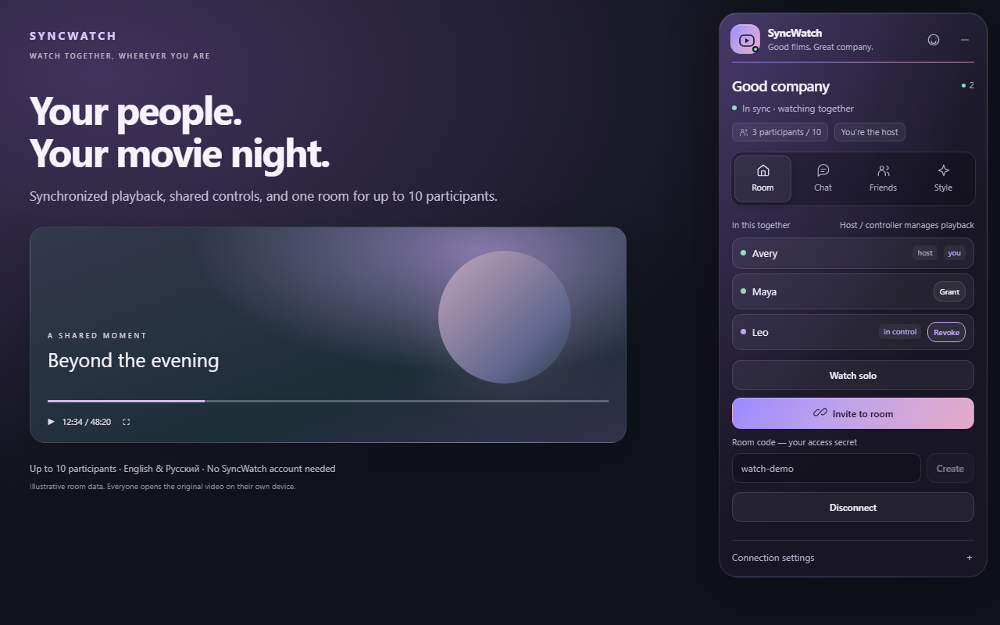

# SyncWatch

Watch HTML videos together in Chrome. SyncWatch synchronizes playback, pause,
seeking and speed for up to 10 participants, with room chat and friend invitations.
Everyone opens the original video on their own device; SyncWatch supplies no films
and does not stream or retransmit audio or video.

[Chrome Web Store](https://chromewebstore.google.com/detail/mincjbhfhimdgnjjonocoogphjgkfffm)
· [Releases](https://github.com/strikec71/SyncWatch/releases)
· [Report a problem](https://github.com/strikec71/SyncWatch/issues)
· [Privacy](https://syncwatch-signal.strikec71.workers.dev/privacy?lang=en)



## Start a movie night

1. Install SyncWatch in Chrome 120+ and reload your video page.
2. Click the toolbar icon to open the Glass Lounge panel.
3. In **Room**, create a code and choose **Connect**. The store build already
   includes the SyncWatch relay; an existing custom server is preserved.
4. Choose **Invite to room** and send the link to a friend. They see the room and
   server and explicitly confirm joining. Both participants need access to the video.
5. Play, pause or seek. For two participants, controls are shared. In larger rooms,
   the host or a participant granted control manages playback. Anyone can request a pause.

**Watch solo** keeps chat available while letting you watch at your own pace.
Every tab has its own room session. Leaving the video site switches to solo mode;
automatic shared navigation stays within the current site.

## Language and appearance

Open **Style → Language** and choose **English**, **Русский**, or **Browser language**.
Russian browser locales resolve to Russian; other browser languages use English.
The choice is saved for the installation and updates open panels without reconnecting
or losing your chat draft. Participant names and free-text messages are never translated.
Quick messages are displayed in the recipient's chosen language.

The same tab offers dark, light or system themes, four gradients, comfortable or
compact sizing, glass opacity, animations and left/right placement. System reduced
motion takes priority. Drag the header to move the panel; minimize to a 52px icon
with connection and unread indicators. **Reset appearance** preserves language,
room, name and server settings.

## Chat, friends and fullscreen

- Chat supports up to 200 characters per message, one message per second across
  text and quick messages, with up to 50 messages held in the background session.
- **Friends → Add friend** creates a link valid for 7 days. Creating another replaces
  it. Both friends use the same relay; presence sharing can be disabled.
- The panel, quick-message wheel and notifications work in supported fullscreen
  containers and video frames. Native HTML video controls have a small **⛶** button.
  Some sites or iframe policies may limit fullscreen behavior.

## Privacy and compatibility

The chosen server processes room codes, viewing-page URLs, content selection,
display names, playback commands, chat and optional friend presence. Installation
private keys stay on the device. HTTPS/WSS protects the connection; the server
can read relayed contents. End-to-end encryption is not provided. No advertising,
analytics, remote JavaScript or sale of data is included.

The extension detects HTML video and includes adapters for YouTube, PlayerJS,
Kodik, Alloha and jut.su. Compatibility depends on each site's current player,
advertisements, frame permissions and autoplay rules. If autoplay is blocked,
click the player. Browser-internal pages and the Web Store do not permit the panel.

## Development

Use Node.js 24. Install dependencies separately in `extension/` and `server/`.

```sh
cd extension
npm ci
npm run verify
npm run build
npx playwright install chromium
npm run test:browser
```

Load `extension/dist/chrome` using **chrome://extensions → Developer mode → Load
unpacked** in a test profile. Plain development builds need a server set manually.
To embed a verified relay, set `SYNCWATCH_SERVER_URL` before building.

```sh
cd server
npm ci
npm run verify
npm run dev
```

The local relay is `ws://localhost:8787`. Public relays require WSS.
See [self-hosting](docs/SELF_HOST.md), [release instructions](docs/PUBLISHING.md),
[localization](docs/LOCALIZATION.md), [verification](docs/FIX-RESULTS.md) and
[release status](docs/releases/STATUS.md). Historical audit findings are not a
description of the current release.
